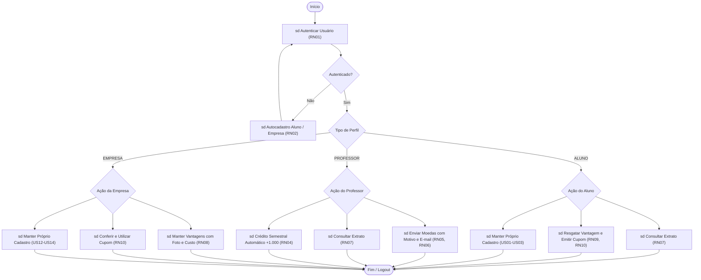
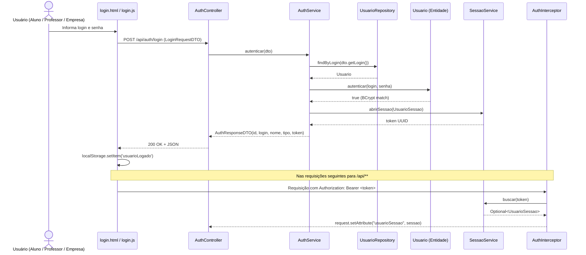
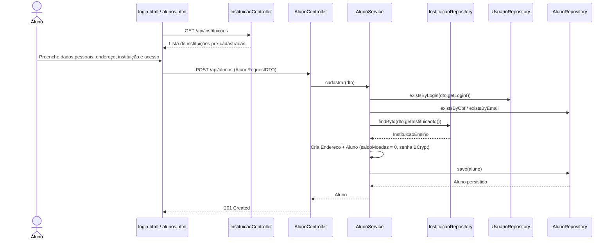
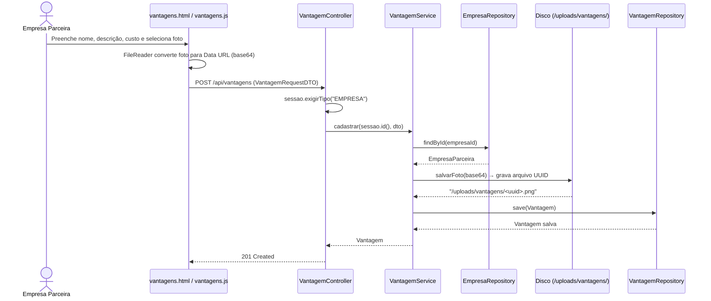
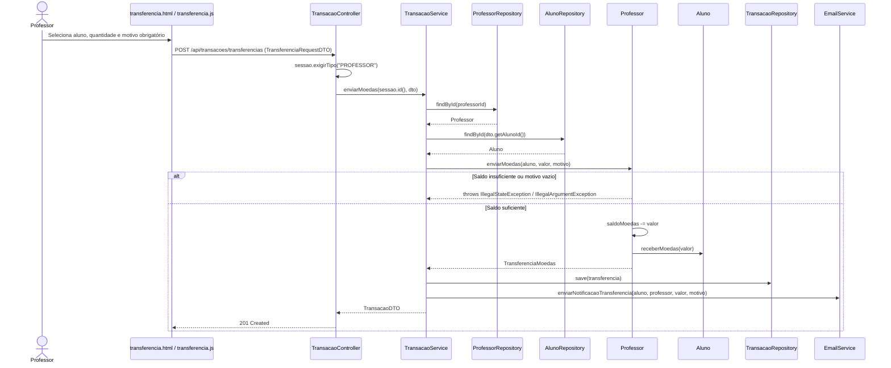
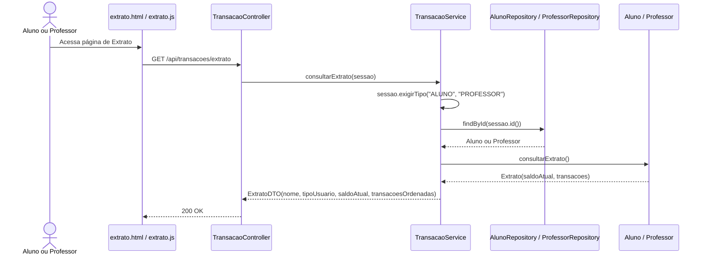
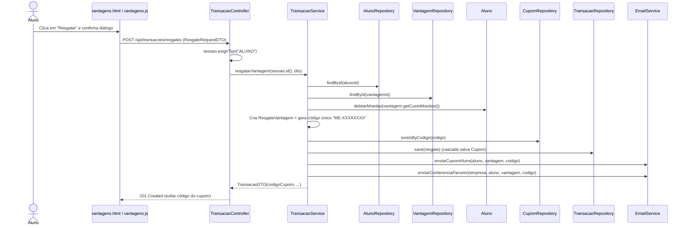
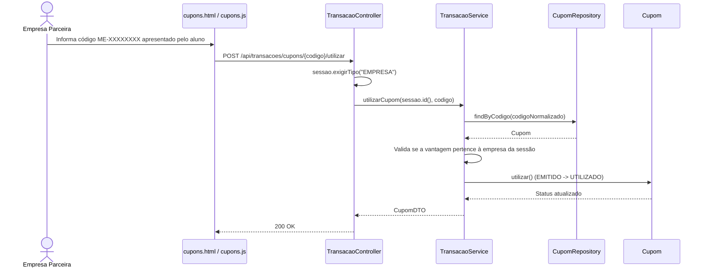

# Release 2 / Sprint 1 (Lab04S01) — Diagramas de Sequência, Visão Geral de Interação e Casos de Uso Restantes

**Participantes do grupo:**
* Bernardo Parreiras Prado
* Gabriel Marcondes Starling Rocha
* João Paulo Aguiar Prado
* Rafael Nagem Volpini

> **Nota sobre os casos de uso:** Todos os casos de uso restantes do enunciado (CRUD de vantagens pela empresa parceira, envio de moedas pelo professor com notificação por e-mail, crédito semestral acumulável de 1.000 moedas, consulta de extrato, resgate de vantagem com emissão de cupom e envio dos dois e-mails, conferência presencial de cupom e autenticação por token) já estão implementados e verificados pelos testes automatizados em [`Sprint3FluxosTests.java`](../../../src/test/java/br/pucminas/moedaestudantil/Sprint3FluxosTests.java).

---

## 1. Diagrama de Visão Geral de Interação (UML Interaction Overview)

---

## 2. Diagramas de Sequência UML

### 2.1 Autenticação e Validação de Sessão (`RN01`)

### 2.2 Autocadastro e Manutenção de Aluno (`RN02`, `US01`–`US03`)

### 2.3 Cadastro de Vantagem pela Empresa Parceira (`RN08`)

### 2.4 Envio de Moedas pelo Professor (`RN05`, `RN06`)

### 2.5 Consulta de Extrato (`RN07`)

### 2.6 Resgate de Vantagem com Cupom e E-mails (`RN09`, `RN10`)

### 2.7 Conferência Presencial do Cupom pela Empresa Parceira (`RN10`)

---

## 3. Alinhamento com os Modelos da Release 1

Todas as atualizações estruturais introduzidas a partir da Sprint 3 (hash BCrypt em `Usuario.definirSenha`, atributo `Professor.ultimoSemestreCreditado`, `Cupom.utilizar()`, `SessaoService`, `AuthInterceptor`, `SemestreScheduler`, `WebConfig` e `InstituicaoController`) estão refletidas nos diagramas desta Release 2 e documentadas em [`docs/sprint3/README.md`](../../sprint3/README.md).
